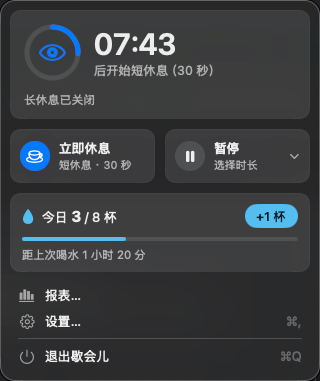
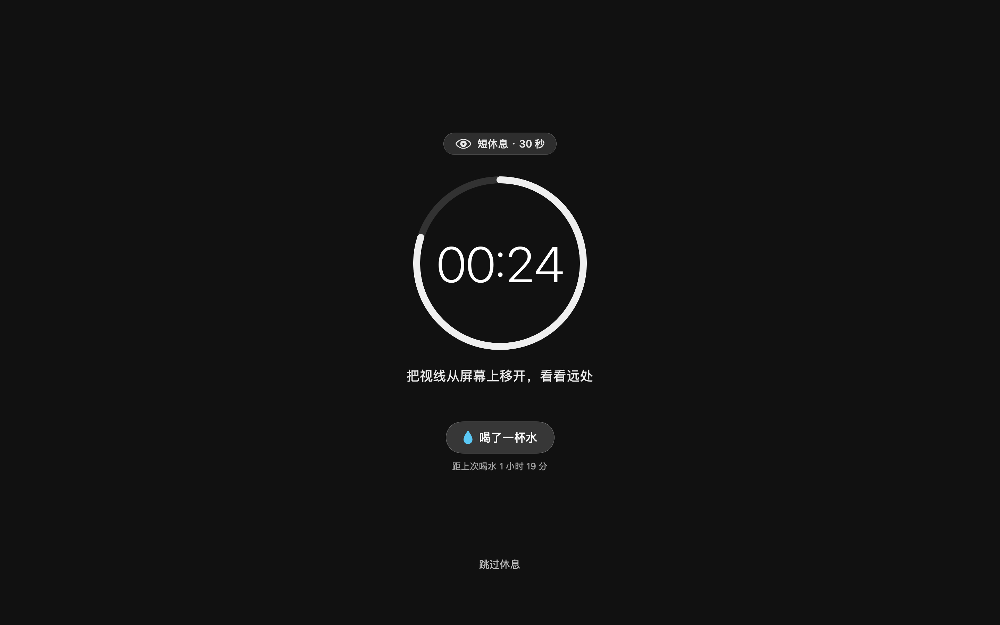
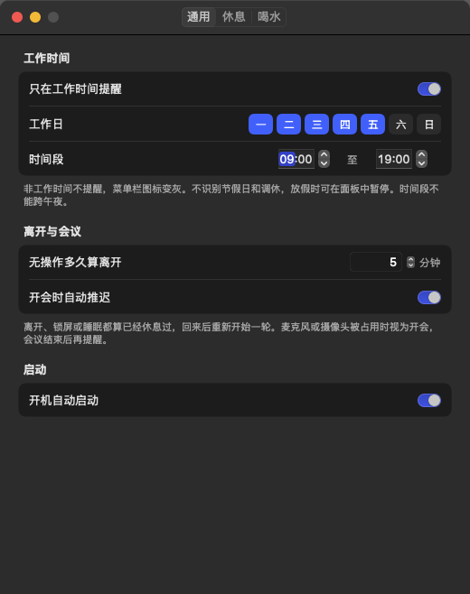
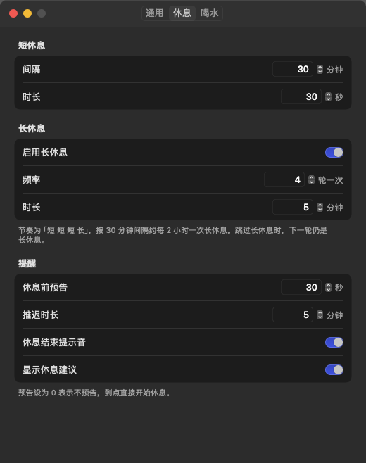
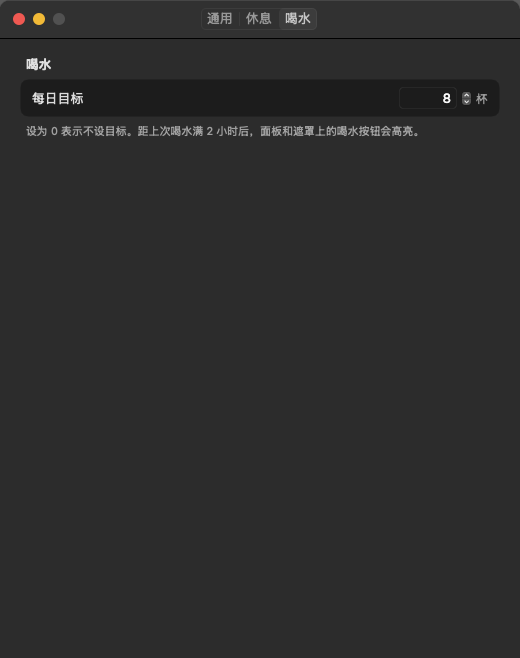

# 歇会儿

常驻 macOS 菜单栏的定时休息和喝水记录工具，仅供自用。

按「短 短 短 长」的节奏提醒休息：到点前先在屏幕右上角弹出预告浮窗，然后全屏遮罩倒计时，结束时自动退出。它会识别工作时间、离开、开会等情形，避免在你不在电脑前或正在说话时弹出遮罩；同时记录每天每次喝水的时间和杯数，并提供近 7 天 / 30 天的报表。

- 原生 Swift（AppKit + SwiftUI），零第三方依赖
- 最低 macOS 14 Sonoma；只在菜单栏出现，不占程序坞
- 数据只存本机，不会上传

## 功能

| 模块    | 说明                                                |
| ----- | ------------------------------------------------- |
| 休息提醒  | 默认每 30 分钟短休息 30 秒，每 4 轮一次 5 分钟长休息；休息前 30 秒预告      |
| 全屏遮罩  | 覆盖所有屏幕、所有桌面和其他 App 的全屏界面，深色毛玻璃 + 大字倒计时 + 随机休息建议   |
| 中断与推迟 | 预告窗可「推迟 5 分钟」或「立即开始」；遮罩上可「跳过休息」，也可直接按 Esc |
| 工作时间  | 默认周一至周五 09:00–19:00 才提醒；非工作时间图标变灰，面板显示下次开始时间      |
| 离开检测  | 无操作 5 分钟、锁屏、睡眠视为已经休息过；播放视频等阻止息屏的场景不算离开            |
| 开会推迟  | 麦克风或摄像头被占用时不打扰，每 60 秒复查，会议结束后再正常预告                |
| 暂停    | 30 分钟、1 小时、直到明天或直到手动恢复                            |
| 喝水    | 面板或遮罩上一键「+1 杯」，5 秒内可撤销；默认每日 8 杯目标；距上次喝水满 2 小时按钮高亮 |
| 报表    | 喝水柱状图（含目标线、达标天数、日均）+ 休息完成/跳过/推迟统计，可删除单条喝水记录       |
| 设置    | 通用 / 休息 / 喝水三页，改完立即保存并生效；登录项默认开启                  |

设置项的默认值和取值范围见 [memory/plan.md](memory/plan.md) §4.3。

## 使用

**菜单栏图标**：只显示图标，形状随状态变化。

| 状态         | 图标            |
| ---------- | ------------- |
| 工作中        | 进度环，剩余时间越少弧越短 |
| 预告 / 会议推迟  | 细圆环 + 中心圆点    |
| 休息中        | 实心圆           |
| 暂停         | 细圆环 + 暂停符号    |
| 非工作时间 / 离开 | 整环变灰          |

**面板**（点图标打开，点别处或按 Esc 收起）

- 上部：进度环、剩余时间和下一次休息的类型、「第 x/N 轮」
- 「立即休息」：马上开始下一轮类型的休息，并算作这一轮
- 「暂停 ▾」：选择暂停时长
- 喝水行：`今日 x/8 杯`、`+1 杯`（5 秒内可「撤销」）、距上次喝水
- 底部：\[报表…]、\[设置… ⌘,]、\[退出 ⌘Q]

**一次休息**

1. 到点前 30 秒，鼠标所在屏幕右上角弹出预告窗，不抢键盘焦点
2. 点「推迟」按设定时长顺延（不限次数，每次都记入报表），点「立即开始」直接进遮罩
3. 遮罩上可点「💧 喝了一杯水」（只记录、不结束休息，每次休息限一次）或「跳过休息」，按 Esc 也是跳过
4. 倒计时结束播放提示音并自动退出，焦点还给原来的 App

**报表**：面板底部「报表…」，顶部切换喝水 / 休息、近 7 天 / 近 30 天；喝水页点某一天可看当天喝水时间并删除单条记录。

**设置**：面板底部「设置…」或 ⌘,。数值框在失焦或回车时校验，超范围只标红、保留上次的值；其余开关和选择改完立即生效。若登录项注册失败，启动分区会显示黄色提示条，此时可到「系统设置 → 通用 → 登录项」手动添加。

## 安装

```bash
# 需要 Xcode 16+（Swift 6）和 XcodeGen
xcodegen generate

DEVELOPER_DIR=/Applications/Xcode.app/Contents/Developer \
xcodebuild -project XieHuiEr.xcodeproj -scheme XieHuiEr \
  -configuration Release -derivedDataPath build build

cp -R "build/Build/Products/Release/歇会儿.app" /Applications/
open /Applications/歇会儿.app
```

产物是 `build/Build/Products/Release/歇会儿.app`（universal、ad-hoc 签名）。首次打开若被系统拦住，到「系统设置 → 隐私与安全性」点「仍要打开」。

## 数据与重置

| 内容       | 位置                                                                      |
| -------- | ----------------------------------------------------------------------- |
| 喝水、休息记录  | `~/Library/Application Support/XieHuiEr/Records.store`（含 `-wal`、`-shm`） |
| 设置、登录项标记 | `defaults` 域 `com.shaozeng.xiehuier`                                    |

只清记录、保留设置：

```bash
osascript -e 'quit app "歇会儿"'
rm -f "$HOME/Library/Application Support/XieHuiEr/Records.store"*
open /Applications/歇会儿.app
```

连设置一起重置：在上面基础上再执行 `defaults delete com.shaozeng.xiehuier`，重新打开后会回到默认设置，并重新尝试注册登录项。

## 开发

```
XieHuiEr/
├── App/        程序入口、AppDelegate（组装各组件）
├── Core/       纯逻辑：BreakSettings、BreakScheduler 状态机、WorkHours
├── System/     IdleMonitor、SessionMonitor、MeetingDetector、LoginItem、SettingsStore
├── Data/       SwiftData 模型、DataStore、WaterCenter
├── UI/
│   ├── MenuBar/   状态栏控制器、进度环图标、面板
│   ├── Break/     预告浮窗、全屏遮罩、休息建议
│   ├── Report/    报表窗口与喝水 / 休息页
│   └── Settings/  设置窗口与三个页面
└── Resources/ Info.plist（LSUIElement）、Assets
```

```bash
# 运行全部单元测试（136 个）
DEVELOPER_DIR=/Applications/Xcode.app/Contents/Developer \
xcodebuild -project XieHuiEr.xcodeproj -scheme XieHuiEr \
  -configuration Debug -derivedDataPath build test
```

约定：

- 零第三方依赖；不新增 Swift 编译警告
- 计时全部用绝对 `Date`，状态机是纯 struct，事件显式传入 `now`，便于毫秒级单测
- 改 `Core/` 或 `Data/` 必须补对应单测
- 界面改动后截图归档到 `.agent/visual/`，并与 `design/mockups/` 的原型对比
- 新增目录后要重新执行 `xcodegen generate`

## 截图






## 已知限制

- ad-hoc 签名，未公证；只在本人机器上使用
- 不识别节假日和调休，放假时请手动暂停
- 仅中文界面；不做 CSV 导出、iCloud 同步、全局快捷键

